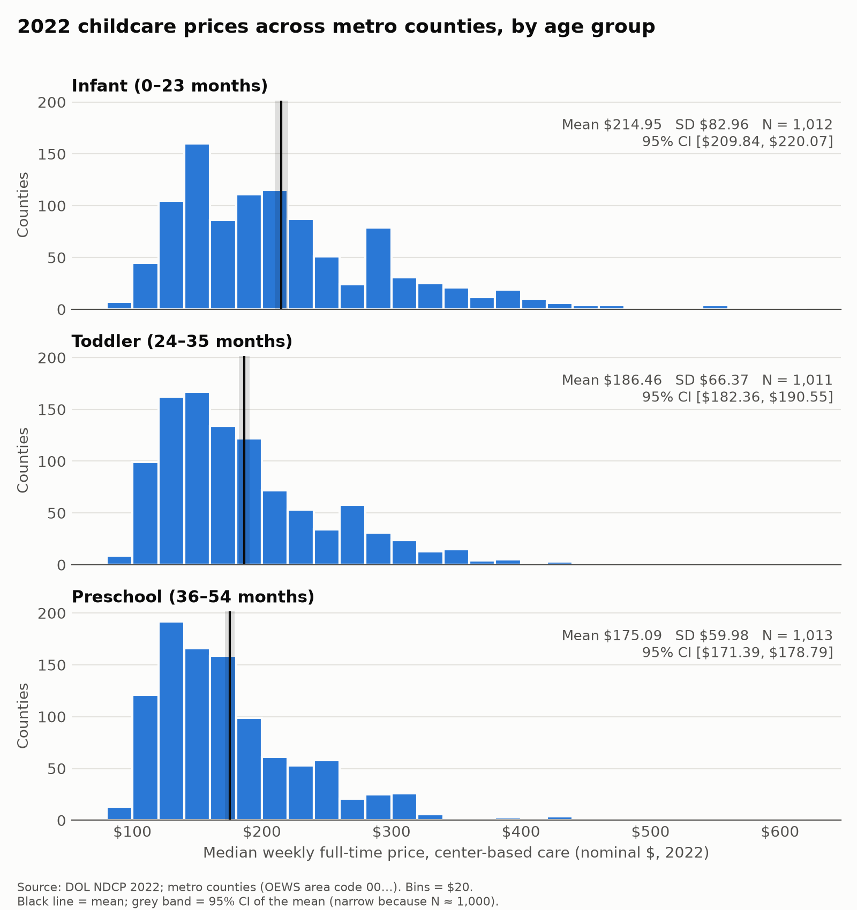
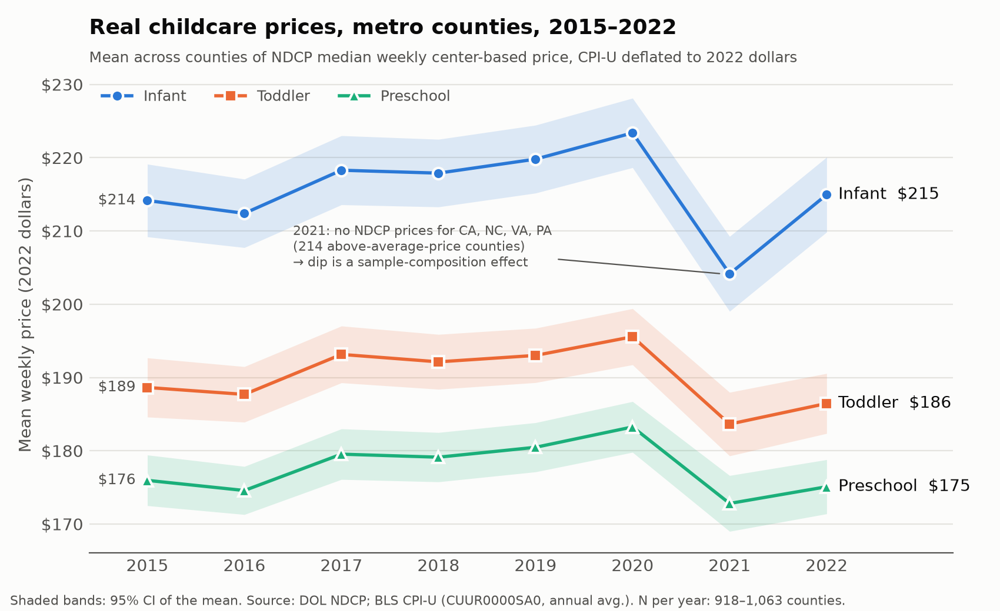
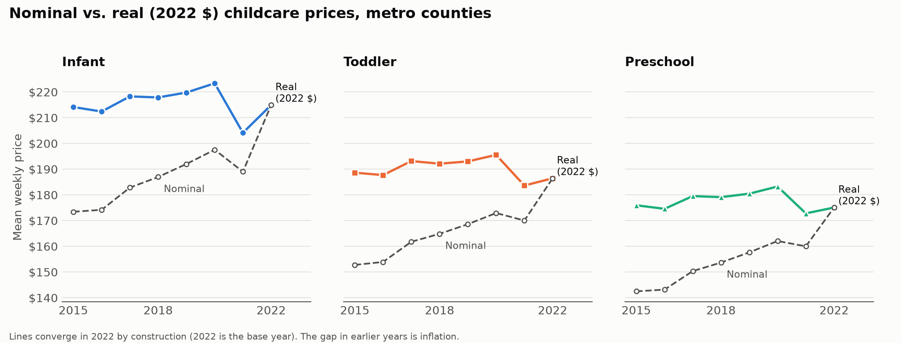
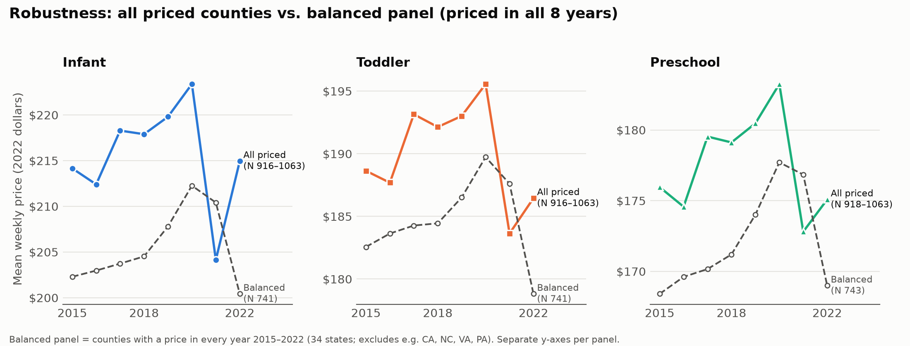

# Problem Set 4 — The Distribution of Childcare Prices

## Q1. Metro analysis sample

**Data.** NDCP county-level workbook `NDCP2022.xlsx` (DOL Women's Bureau), study years 2015–2022. We use
median weekly full-time prices for center-based care: `MCINFANT` (0–23 months), `MCTODDLER` (24–35 months),
and `MCPRESCHOOL` (36–54 months), in nominal dollars (NDCP Technical Report, Sept. 2024, Appendix C).

**Sample definition.** Each NDCP county-year is joined to the course crosswalk `county_oews_crosswalk.csv` on
(year, 5-digit county FIPS). The crosswalk is year-specific, so each county's metro status is taken from the
same year. A county-year is kept if its OEWS area code begins with `00` (metropolitan area); counties in
nonmetropolitan areas are dropped. FIPS and OEWS codes are handled as text so leading zeros are preserved
(NDCP stores FIPS as a number, e.g. `1001`, which we zero-pad to `01001`).

**Result.**

| Year | NDCP counties | Nonmetro dropped | **Metro counties** | Metro areas | With preschool price |
|---:|---:|---:|---:|---:|---:|
| 2015 | 3,220 | 1,987 | **1,233** | 388 | 1,003 |
| 2016 | 3,220 | 1,987 | **1,233** | 388 | 1,025 |
| 2017 | 3,220 | 1,986 | **1,234** | 389 | 1,063 |
| 2018 | 3,220 | 1,987 | **1,233** | 388 | 1,063 |
| 2019 | 3,220 | 1,985 | **1,235** | 389 | 1,063 |
| 2020 | 3,221 | 1,986 | **1,235** | 389 | 1,063 |
| 2021 | 3,221 | 1,986 | **1,235** | 389 | 918 |
| 2022 | 3,221 | 1,986 | **1,235** | 389 | 1,013 |

Infant and toddler counts differ from the preschool count by at most two counties per year.

**Checks.**
- Every NDCP county-year matches a crosswalk row, and state abbreviations agree.
- The only crosswalk metro counties with no NDCP row are two outdated FIPS codes: `12025` (Dade County, renamed
  Miami-Dade `12086` in 1997) and `51515` (Bedford city, merged into Bedford County `51019` in 2013). Both
  current counties are in the sample, so nothing is lost.
- The metro county set is almost constant: 1,232 of 1,236 distinct counties are metro in all eight years (the
  exceptions are Jerome and Twin Falls, ID, from 2019; Garfield, OK, from 2017; Berkshire, MA, through 2017).
  Trends over time therefore reflect price changes, not changes in which counties are in the sample.

**Missing prices.** 222 of the 1,235 metro counties have no 2022 preschool price. They are concentrated in a few
states: Puerto Rico 69, Indiana 44, Pennsylvania 37, Missouri 34, Arkansas 20, Illinois 7, New Mexico 7,
Florida 2, Vermont 2. Missingness is therefore not random across states, which should be kept in mind when
interpreting averages.

**Imputed prices (data-handling decision).** NDCP fills gaps in state market-rate surveys with imputations,
recorded in five-digit flags on the fine age bands (Technical Report pp. 9–26). In the 2022 metro sample, 89.2%
of preschool prices involve at least one imputation: interpolation between survey years (68.4%), conversion to
a weekly price (37.8%), a percentile model (13.4%), or a county model from statewide data (5.3%). We **keep all
NDCP prices**. Dropping imputed values would leave only 109 of 1,013 counties, all from four states (New York 38,
Ohio 38, Wisconsin 26, Connecticut 7), a much smaller and clearly non-representative sample. The `MCPreschool_flag` variable is **not** an imputation
indicator: it records how the age-group price was aggregated from its age bands.

*Files:* `scripts/04_prepare_ndcp.py`, `scripts/05_build_metro_sample.py` →
`data/analysis/ndcp_metro_2015_2022.csv`, `output/tables/ps4_q1_sample_construction.csv`,
`output/tables/ps4_q1_imputation_2022.csv`.

## Q2. 2022 price distributions by age group

| Age group | N | Mean | SD | 95% CI for the mean |
|---|---:|---:|---:|---|
| Infant (0–23 months) | 1,012 | $214.95 | $82.96 | [$209.84, $220.07] |
| Toddler (24–35 months) | 1,011 | $186.46 | $66.37 | [$182.36, $190.55] |
| Preschool (36–54 months) | 1,013 | $175.09 | $59.98 | [$171.39, $178.79] |

2022, metro counties, NDCP median weekly full-time price for center-based care, nominal dollars; county is the
unit of observation. 95% CI = mean ± t(0.975, N−1)·SD/√N.

**Discussion** *(written by the student; AI checked spelling and grammar only)*

The 2022 data shows a clear age-based price change across metropolitan counties. The prices decrease as the children get older, meaning infants are the most expensive overall, with an average weekly price of $214.95, followed by toddler care at $186.46 and preschool care at $175.09. This means infant care costs about $40 more per week than preschool care on average. A probable explanation could be that infants require much more staff to take care of them successfully.

Also, the variance follows the same trend, with infant prices having the highest SD.

All 3 graphs were skewed to the right, which probably means that high-price counties pull up the average.

The 95% confidence interval for the infant mean is [$209.84, $220.07], compared with [$182.36, $190.55] for toddlers and [$171.39, $178.79] for preschoolers. These are quite narrow intervals, which means our average prices are estimated precisely.

Overall, infant care stands out as the most costly, and has the highest geographical variation.

*Files:* `scripts/06_ps4_q2_distribution_2022.py`, `scripts/07_ps4_q2_factsheet.py`; tables in `output/tables/ps4_q2_*.csv`.

## Q3. Real (2022-dollar) price trends, 2015–2022

**Method.** All NDCP prices are converted to constant 2022 dollars with the CPI-U for All Urban Consumers
(BLS series CUUR0000SA0, annual average): real = nominal × CPI₂₀₂₂ / CPI_year. For each year and age group we
plot the mean across metro counties of the NDCP median weekly center-based price, with 95% CIs.

| Year | CPI-U | × to 2022 $ | Infant | Toddler | Preschool |
|---:|---:|---:|---:|---:|---:|
| 2015 | 237.017 | 1.2347 | $214.16 | $188.64 | $175.96 |
| 2016 | 240.007 | 1.2194 | $212.40 | $187.69 | $174.58 |
| 2017 | 245.120 | 1.1939 | $218.29 | $193.15 | $179.54 |
| 2018 | 251.107 | 1.1655 | $217.89 | $192.14 | $179.12 |
| 2019 | 255.657 | 1.1447 | $219.80 | $193.01 | $180.47 |
| 2020 | 258.811 | 1.1308 | $223.38 | $195.56 | $183.25 |
| 2021 | 270.970 | 1.0800 | $204.14 | $183.64 | $172.81 |
| 2022 | 292.655 | 1.0000 | $214.95 | $186.46 | $175.09 |

Mean weekly price in 2022 dollars; N = 916–1,063 counties per year.

**Robustness: balanced panel.** In 2021, NDCP has no prices for CA, NC, VA and PA (214 counties that are more
expensive than average), which lowers the 2021 mean. The figure below repeats the trend for the 741–743 counties
priced in all eight years.

**Discussion** *(written by the student; AI checked spelling and grammar only)*

The key takeaway here is that childcare prices were essentially flat between 2015 and 2022. The nominal price increases closely match the inflation during this period. If we now look closer within the period, there are some changes observable. From 2015 to 2019 the real childcare prices were increasing, meaning that relative to consumer prices, childcare got more expensive during that period. From 2019 to 2022 inflation jumped up, and childcare prices did not keep up. Overall, the ranking of prices we saw in Q2 remained the same with infants still being the most expensive. The 2021 dip in prices could be due to data missing from some probably more expensive counties.

*Files:* `scripts/08_ps4_q3_real_trends.py`; `output/tables/ps4_q3_trends_real.csv`, `output/tables/ps4_q3_changes.csv`;
fact sheet `output/ps4/PS4_Q3_factsheet.md`.
